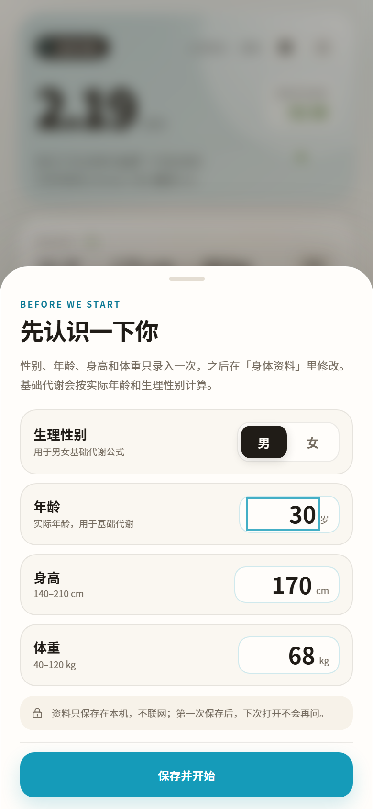
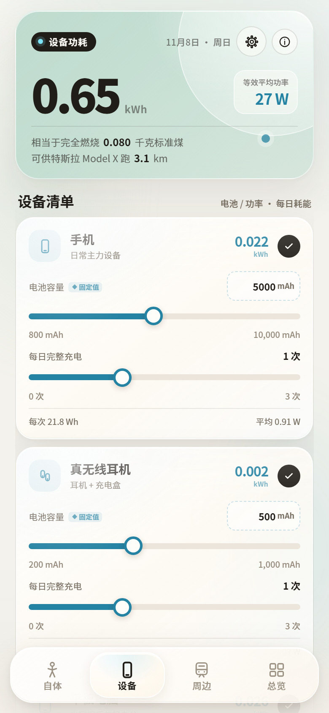
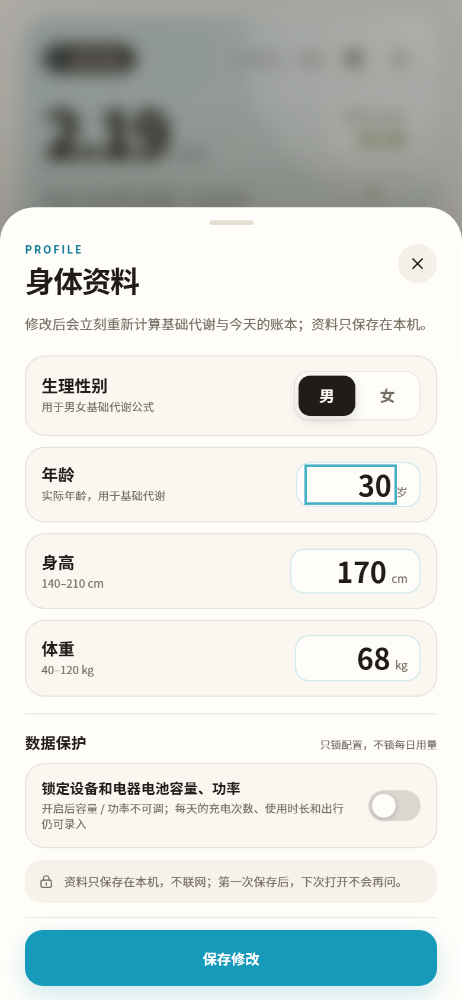
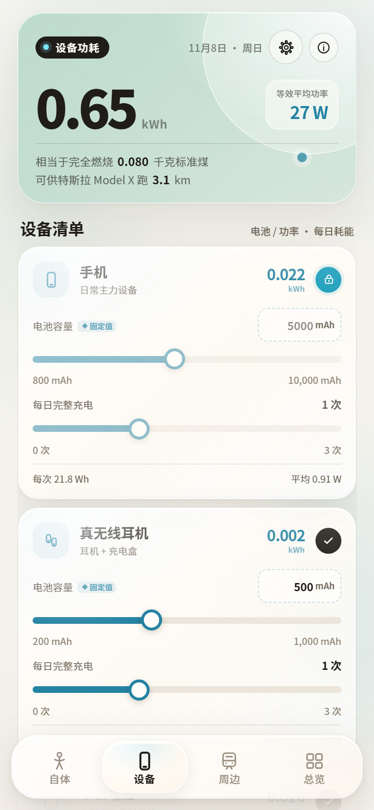
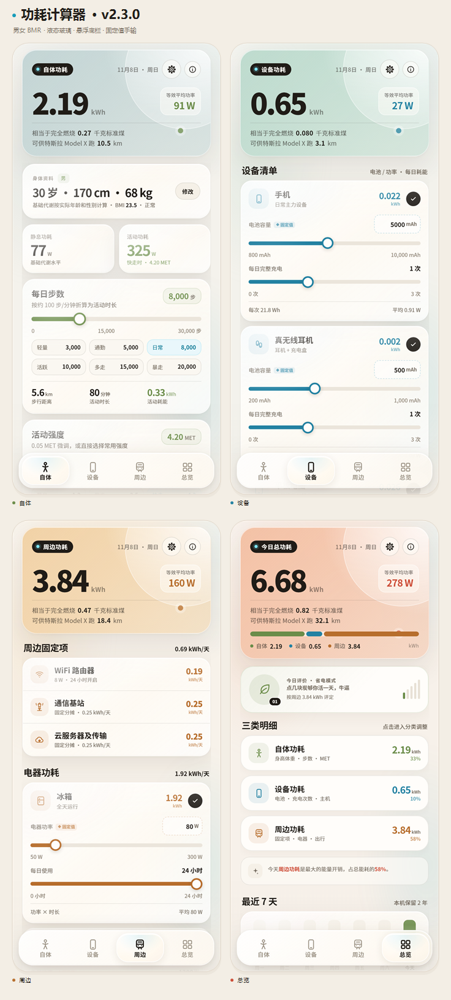
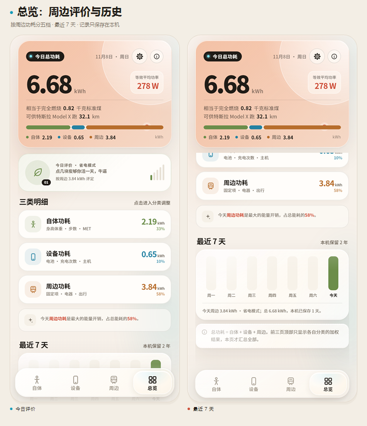
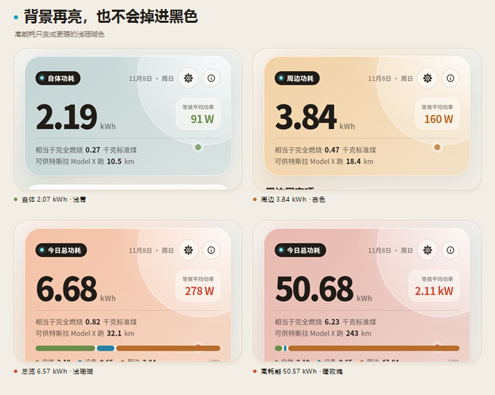
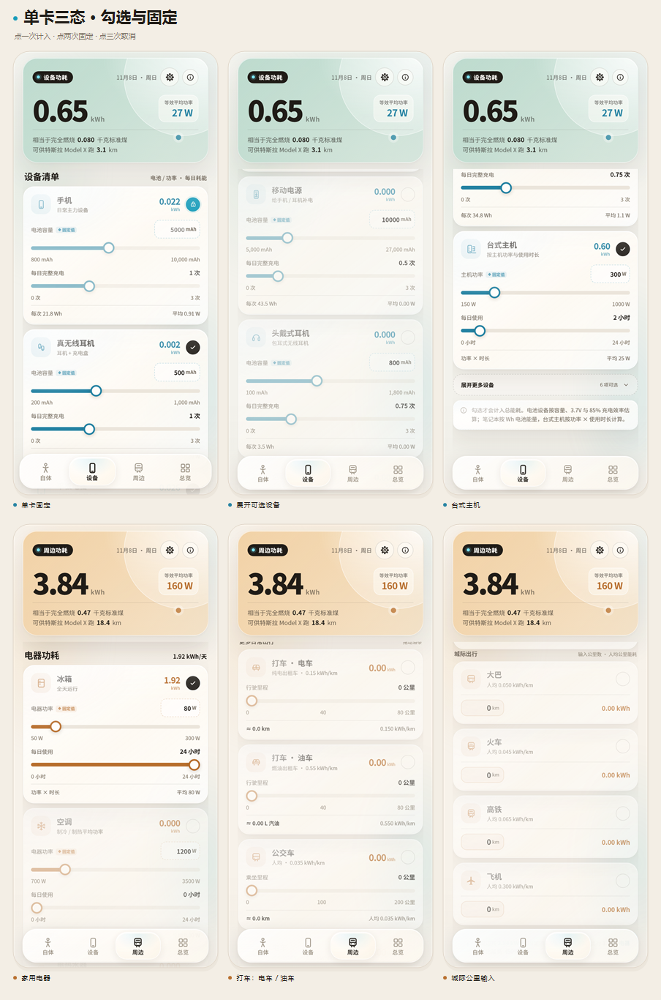

# 功耗计算器 · Power Ledger

把「身体代谢 + 设备充电 / 主机用电 + 家用电器 + WiFi / 基站 / 云服务器 + 出行」放进同一本每日能量账本的 **Android / iOS 离线应用**。四个分页，滑条与公里数输入实时联动。

v1.5 把界面从深色霓虹改成了**暖白纸感**；v1.6 把「打车」拆成电车和油车；v1.7 补上评价等级和本机历史，并交付可直接在 Mac 上打开的 iOS Xcode 工程。

**v2.3.0 是男女基础代谢版，Android / iOS / PWA 已同步**：首次打开和设置里新增「生理性别」选择，BMR 改用 Mifflin-St Jeor 的男性常数 `+5` / 女性常数 `−161`，不再使用男女平均值。卡片仍是暖白液态玻璃，底部为悬浮 dock，设备电池容量、主机功率和电器功率可直接输入固定值并跨日保留。

















## 安装

### Android

- 安装包：[`dist/功耗计算器-v2.3.0.apk`](dist/功耗计算器-v2.3.0.apk)
- 支持系统：Android 6.0（API 23）及以上
- 体积：102 KB；不包含原生库，不依赖 Google Play 服务
- 首次安装时，如果系统提示未知来源，允许本次安装即可
- **不申请任何权限，不联网，不上传数据**；年龄、身高、体重、设置和历史只保存在本机
- 版本：`2.3.0`，versionCode `15`

SHA-256：

```text
55de0c84422caa85e4a372c035cf10d37385547a4da41c5c17cacbaf6eaa595e
```

### 没有 Mac：PWA / 网页版

这是不经过 App Store、也不需要 Mac 的用法；在 iPhone / iPad 的 Safari 里打开后「添加到主屏幕」，会以独立窗口运行。

- **PWA 包（推荐）**：[`dist/功耗计算器-v2.3.0-PWA.zip`](dist/功耗计算器-v2.3.0-PWA.zip)
- **单文件网页版**：[`dist/功耗计算器-v2.3.0-web.html`](dist/功耗计算器-v2.3.0-web.html)（只适合快速预览/单文件托管，没有离线缓存）
- PWA 需要托管在 **HTTPS** 静态站点；临时压测或本地文件不能完整注册 Service Worker
- 最简单的免费托管：[Cloudflare Pages 的 drag and drop](https://developers.cloudflare.com/pages/get-started/direct-upload/) 支持直接上传 zip；也可以用自己的 GitHub Pages / Netlify 等静态托管
- 首次打开需要联网，加载一次后会把页面缓存到本机；之后断网也能从主屏幕启动。历史、身体资料和单卡固定只保存在该设备的 Safari 站点数据里
- 它不是签名 IPA，不能上架 App Store；如果要真正的原生安装，仍需要 macOS/Xcode 编译和 Apple 签名

### 有 Windows：原生自签安装

如果更想要真正的原生 App，可以用仓库自带的 GitHub Actions workflow：

1. 把本仓库推到 GitHub（免费仓库即可）；根目录的 `.github/workflows/build-unsigned-ipa.yml` 会构建 `ios/PowerLedger.xcodeproj`；
2. 在 Actions 里手动运行 **Build unsigned iOS IPA**，由 GitHub 免费的 macOS runner 编译出未签名 IPA；
3. 在 Windows 用 **Sideloadly** 连接 iPhone / iPad，用免费 Apple ID 重签安装。

如果只把 `ios/` 子目录作为独立仓库上传，`ios/.github/workflows/build-unsigned-ipa.yml` 也保留了一份同样的 workflow。

免费 Apple ID 的签名 **7 天有效**，到期重签；不需要 Mac，也不需要 $99 Apple Developer。完整步骤见 [`ios/WINDOWS-SIDELOAD.md`](ios/WINDOWS-SIDELOAD.md)，zip 内也带同一份说明。

PWA zip SHA-256：

```text
94342e6233f10b192da0a49981507131403cddd283f4fea0b95242d50d360206
```

单文件网页版 SHA-256：

```text
82b4144f0f83e0a8f6d5b5874663f94336cde9e829f8a6103222b6f11829373a
```

### iOS

> iOS 工程已同步到 v2.3.0（Build 15），页面与 Android 同源，历史保留 730 天。**仍不提供 IPA**：当前环境是 Windows，没有 Xcode / Apple 签名工具。

- Xcode 工程：[`dist/功耗计算器-iOS-v2.3.0-Xcode.zip`](dist/功耗计算器-iOS-v2.3.0-Xcode.zip)
- 内容：SwiftUI + WKWebView 工程、同源 v2.3.0 离线页面、AppIcon、启动色、Info.plist、隐私清单、共享 Scheme、GitHub Actions 未签名 IPA workflow、Windows Sideloadly 说明
- Bundle ID：`com.powercalc.ledger`；最低 iOS 15.0；版本 2.3.0（Build 15）
- 有 Mac：Xcode 中选择自己的 Team 后运行；要上真机 / TestFlight：`Product → Archive`，再用自己的 Apple Developer 签名导出
- 只有 Windows：上传到 GitHub，跑 workflow 得到未签名 IPA，再用 Sideloadly + 免费 Apple ID 安装；7 天有效，详见 [`ios/WINDOWS-SIDELOAD.md`](ios/WINDOWS-SIDELOAD.md)
- 详细说明见 [`ios/README.md`](ios/README.md)

iOS zip SHA-256：

```text
8210ae4d8669176fb7a8799e340f840de2d778d2308dfe836919512147dfee54
```

## v2.3.0 的改动（Android / iOS / PWA）

- **生理性别**：首次资料录入新增「男 / 女」选择，设置里随时可改；资料保存后 BMR 立即重算
- **BMR 分男女**：男性 `10×体重 + 6.25×身高 − 5×年龄 + 5`；女性 `10×体重 + 6.25×身高 − 5×年龄 − 161`（kcal/天）
- **默认示例改为男性**：示例资料 30 岁 / 170 cm / 68 kg 的 BMR 为 **1597.5 kcal/天**，默认总览约 **6.68 kWh / 278 W**；女性同资料约 **1431.5 kcal/天**
- **旧数据迁移**：旧版本资料没有性别字段时按男性常数计算；打开设置选择女性并保存即可切换，换日归零不会重置性别
- 身体资料摘要现在显示「男 / 女 · 年龄 · 身高 · 体重」；说明页同步写明男女公式
- Android 2.3.0 / versionCode 15；iOS 2.3.0 / Build 15；PWA 缓存 `powercalc-pwa-v2.3.0`

## v2.2.0 的改动（Android / iOS / PWA）

- **液态玻璃卡片**：暖白半透明表面、柔光高光跟随指针、细边框和轻微按压缩放；保持浅色纸面，不引入深色 / 霓虹背景
- **悬浮底栏**：底部分页变成居中悬浮 dock，带玻璃模糊、选中胶囊滑动动画、点击回弹和滚动收缩；内容在 dock 下方留出滚动空间
- **动态交互**：卡片按压缩放、底部选中胶囊弹簧过渡、轻量背景光斑漂移；支持 `prefers-reduced-motion`
- **固定值手输**：手机 / 平板 / 耳机等电池容量、笔记本 Wh、主机功率、电器功率旁新增数字输入框；点击后可键盘输入，精确值保存在本机
- **换日不变**：固定值与容量 / 功率不参与每日归零；模型不再把 4321 mAh、437 W 这类精确值按滑条步进取整，重新打开仍然保留
- **配置锁兼容**：开启「锁定设备和电器电池容量、功率」后，数字输入框和滑条一起冻结；每天的充电次数、使用时长、出行仍可调
- Android 2.2.0 / versionCode 14；iOS 2.2.0 / Build 14；PWA 缓存 `powercalc-pwa-v2.2.0`

## v2.1.2 的改动（Android / iOS / PWA）

- **换日归零只清每日会变的用量**：步数、活动强度、设备充电次数 / 主机使用时长、电器使用时长、出行里程 / 时长
- 设备电池容量、笔记本 Wh、台式主机功率、电器功率**不会因为换日改变**
- 设置新增开关：**「锁定设备和电器电池容量、功率」**
  - 开启后冻结设备电池容量、笔记本 Wh、主机功率和电器功率
  - 每天的充电次数、使用时长、出行仍可正常调整
  - 开关状态保存在本机；换日归零后仍然保持
  - 单卡三态固定仍可独立使用
- 旧版本升级后第一次打开会自动清一次旧的当日用量，同时保留容量 / 功率
- Android 2.1.2 / versionCode 13；iOS 2.1.2 / Build 13；PWA 缓存 `powercalc-pwa-v2.1.2`

## v2.1.1 的改动（Android / iOS / PWA）

- **修复“前一天数据第二天不归零”**
- 每天首次打开、跨天后回到前台、或页面持续打开跨过午夜时，会把昨日用量按昨日日期归档
- 归档后清零今日的：步数、活动强度（回到 1.3 MET）、设备充电次数 / 主机使用时长、电器使用时长、全部出行里程 / 时长
- 保留：年龄 / 身高 / 体重、设备容量与功率、电器功率、已勾选项目、已展开状态和单卡固定（固定会解锁，方便新一天编辑）
- 之前版本升级上来的旧数据没有日期标记，会在更新后第一次打开时自动清一次旧的可调用量
- 换日归零后仍有约 **2.45 kWh** 的基线：基础代谢 + WiFi / 基站 / 云固定项，这些每天都会发生，不会变成 0
- Android 2.1.1 / versionCode 12；iOS 2.1.1 / Build 12；PWA 缓存 `powercalc-pwa-v2.1.1`

## v2.1.0 的改动（Android / iOS）

- 修正顶部设置齿轮：改为轴对称的 8 齿齿轮
- 删掉汇总卡片的全局固定键，固定下放到**每张子卡片**
- 子卡片右上角圆圈改为三态：未勾选 → **点一次勾选**（计入，可调）→ **点两次固定**（计入，卡片内滑条/输入框冻结）→ **点三次取消勾选**；再继续循环
- 固定状态按卡片分别保存，不影响其他卡片；重置示例值会清空所有固定
- 评价档位改名：**省电模式 / 节能模式 / 均衡模式 / 性能模式 / 高耗能模式**
- 评价改为按**周边功耗**（固定项 + 电器 + 出行）分档：≤5 / ≤15 / ≤25 / ≤40 / 更高
- 删除「相当于几份炸鸡排」，改为「可供特斯拉 Model X 跑 X km」（按约 20.8 kWh/100km，1 kWh ≈ 4.8 km）
- 历史评价同步按周边功耗判定；今日评价卡显示「按周边 X kWh 评定」
- 版本号 2.1.0；Android versionCode 11，iOS Build 11

## v2.0.0 的改动（Android）

- **首次打开录入一次**年龄、身高、体重；以后不再询问，顶部齿轮或「身体资料 → 修改」进入设置
- **基础代谢改用实际年龄**：`10×体重 + 6.25×身高 − 5×年龄 − 78`，不再用固定 25 岁常数
- 身高 / 体重滑条从自体页移除，改为只读资料卡，减少误触
- 设备、电器、出行每个子项右上角加**计入勾选**；未勾选时该项为 0
- 点击锁按钮固定全部调节（39 条滑条 / 26 个勾选按钮）；**v2.1 已改为子卡片三态固定**
- 步数滑条精确到 **50 步**，并新增 3,000 / 5,000 / 8,000 / 10,000 / 15,000 / 20,000 一键预设
- 今日出行首屏只留**地铁、电动车**；其余 9 项（含城际）收进「展开更多出行」
- 设备首屏只留**手机、真无线耳机、平板电脑、台式主机**；其余 6 项收进「展开更多设备」，默认未勾选
- 五档评价文案换成你写的五条（见下表）
- 版本号 2.0.0，versionCode 10；iOS 工程保持 v1.7.0 不动

## v1.7.1 的改动

- Android 端历史保留从 90 天提升到 **730 天（约 2 年）**
- 总览历史说明同步改为「本机保留 2 年」
- iOS 工程按你的要求**保持不动**，仍是 90 天版本
- Android 版本号 1.7.1，versionCode 9

## v1.7.0 的改动

- 总览新增 **五档评价等级**
- 总览新增 **最近 7 天历史**柱状图，按自然日记录总功耗，本机保留最近 **90 天**
- 历史与当前设置分别持久化；Android 使用 localStorage，iOS 通过 WKWebView 桥接写入 `UserDefaults`
- 新增 iOS Xcode 工程：SwiftUI + WKWebView、离线文件加载、历史/设置持久化桥接、浅色图标与启动页
- 版本号 1.7.0，versionCode 8

## v1.6.0 的改动

- 「打车」拆成两张卡：**打车 · 电车** 和 **打车 · 油车**
- 电车出租车按 **0.15 kWh/km** 计算，油车出租车按 **0.55 kWh/km** 计算
- 油车卡显示对应汽油升数；电车卡只显示里程和电耗
- 两张卡默认里程都是 0；旧版本里设置的“打车”里程继续保留在油车卡上
- 出行方式总数变为 11 种，其中日常滑条 7 条
- 版本号 1.6.0，versionCode 7

## v1.5.0 的改动

- 全新 **暖白纸感浅色主题**：奶油底色、白色圆角卡片、黑色粗体标题、天青蓝操作按钮
- 大字号 Hero、顶部黑色分类标签、更多留白，减少深色玻璃与霓虹感
- 背景仍随当前页 kWh 变化，但只使用浅绿、浅蓝、杏色、浅珊瑚、暖玫瑰，**不再压到纯黑**
- 说明页改为浅色抽屉；按钮、焦点、滑条统一为新的纸感配色
- 同步更新浅色 App 图标、状态栏 / 导航栏图标（旧系统使用深色导航栏）
- 版本号 1.5.0，versionCode 6

## 四个分页

1. **自体**：生理性别、年龄、身高、体重、步数、MET；示例资料为男性 30 岁 / 170 cm / 68 kg，默认 **2.19 kWh**
2. **设备**：首屏 4 类核心设备 + 展开 6 类可选设备；默认只计入手机、耳机、平板、台式主机，合计 **0.650 kWh**
3. **周边**：固定项 0.692 + 冰箱 1.92 + 地铁 / 电动车 1.23 = **3.84 kWh**
4. **总览**：默认 **6.68 kWh / 278 W**，含三类占比和等价换算；默认周边 3.84 kWh，评价为「省电模式」，下方带最近 7 天历史

> 示例资料可在设置里改；你自己的生理性别、年龄、身高、体重会得到不同的 BMR。默认设备/电器/出行只勾选核心项，展开后勾选更多项就会计入。重置示例值会保留身体资料和历史记录，但会清空所有单卡固定。第二天首次打开时，昨日用量会归档，今日可调用量清零；基础代谢和固定项仍计入，所以男性示例基线约 2.55 kWh。

## 评价等级

今日评价按**周边功耗**（固定项 + 电器 + 出行）给出五档，文案继续用你写的那五条：

| 周边功耗 | 档位 | 你写的评价 |
| --- | --- | --- |
| ≤ 5 kWh | 省电模式 | 点几块炭够你活一天，牛逼 |
| ≤ 15 kWh | 节能模式 | 控制全球变暖有你一份功劳 |
| ≤ 25 kWh | 均衡模式 | 试着把空调固定在26度，指不定会少花几块钱 |
| ≤ 40 kWh | 性能模式 | 耗能有点高，是不是需要注意下账单... |
| > 40 kWh | 高耗能模式 | 你知道你带得动几张GPU吗...不告诉你！ |

默认周边 3.84 kWh 落在「省电模式」；周边 15 kWh 以内都至少是节能/省电。评价卡会显示「按周边 X kWh 评定」；它同时会出现在历史记录里。

## 历史记录

- 每个自然日保存一条记录：总功耗、自体 / 设备 / 周边三项；档位按当日周边功耗判定
- Android 和 iOS 都按本机时区归档，保留最近 **730 天（约 2 年）**
- iOS 通过 WKWebView 桥接写入 `UserDefaults`，四个键分别是当前设置、历史、身体资料和单卡固定状态
- 总览展示最近 7 天；今天的数据会随着滑条、勾选和资料修改实时更新
- 每天首次打开会自动归档昨日并清零今日可调用量；基础代谢和固定项仍每天计入
- **只保存在本机**，不上传、不做云同步；Android 用 localStorage，iOS 用 `UserDefaults` 桥接
- 历史记录与“恢复示例值”互不影响：重置当前设置不会清空历史，也不会清掉身体资料

## 能量等价换算

每个分页 kWh 下方都会显示：

- 相当于完全燃烧多少千克标准煤：`1 kWh ≈ 0.1228 kg 标准煤`
- 可供特斯拉 Model X 跑多少公里：按约 **20.8 kWh/100km**，1 kWh ≈ **4.8 km**

例如男性默认总览：6.68 kWh ≈ 完全燃烧 **0.82 kg 标准煤**，或够特斯拉 Model X 跑 **32.1 km**。这只是能量数量级换算，不代表设备或出行真的在给车充电。

## 设备清单

| 设备 | 容量 / 功率范围 | 默认值 |
| --- | --- | --- |
| 手机 | 800–10,000 mAh | 5,000 mAh，1 次 |
| 平板电脑 | 3,000–15,000 mAh | 8,000 mAh，0.75 次 |
| 笔记本电脑 | 40–120 Wh | 60 Wh，1 次 |
| 移动电源 | 5,000–27,000 mAh | 10,000 mAh，0.5 次 |
| 真无线耳机 | 200–1,000 mAh | 500 mAh，1 次 |
| 头戴式耳机 | 100–1,800 mAh | 800 mAh，0.75 次 |
| 运动相机 | 800–5,000 mAh | 1,800 mAh，0.5 次 |
| 相机 | 800–5,000 mAh | 2,400 mAh，0.25 次 |
| 拍立得 | 800–3,000 mAh | 1,200 mAh，0.25 次 |
| 台式主机 | 150–1,000 W，0–24 h | 300 W × 2 h |

```text
电池设备每次充满（Wh） = 容量mAh × 3.7V ÷ 1000 ÷ 0.85
笔记本每次充满（Wh）   = 电池Wh ÷ 0.85
每日耗能（kWh）        = 每次充满Wh × 每日完整充电次数 ÷ 1000
台式主机每日耗能（kWh） = 功率W × 使用时长h ÷ 1000
```

每张设备卡右上角有勾选圆圈：**勾选才计入**，再点一次固定该卡。首屏显示手机、真无线耳机、平板电脑、台式主机；其余 6 类在「展开更多设备」里，默认未勾选。默认只计入 4 类核心设备，合计 **0.650 kWh/天**；全部勾选时约 **0.753 kWh/天**。

## 周边功耗

### 固定项（每天计入）

- WiFi 路由器：8 W × 24 h = 0.192 kWh/天（界面显示 0.19）
- 通信基站：固定 0.25 kWh/天
- 云服务器及传输：固定 0.25 kWh/天

固定项合计 **0.692 kWh/天**。

### 电器功耗

| 电器 | 功率范围 | 默认值 |
| --- | --- | --- |
| 冰箱 | 50–300 W | 80 W × 24 h = 1.92 kWh |
| 空调 | 700–3,500 W | 1,200 W × 0 h |
| 电热水器 | 1,000–3,000 W | 2,000 W × 0 h |
| 洗衣机 | 200–1,200 W | 500 W × 0 h |
| 电视 | 50–400 W | 120 W × 0 h |

```text
电器每日耗能（kWh） = 功率W × 使用时长h ÷ 1000
```

每台电器右上角也有三态勾选圆圈：**勾选才计入**，再点一次固定该卡。默认只勾选冰箱，合计 **1.92 kWh/天**；其余电器默认未勾选，勾选后按功率 × 时长计入。

### 出行

**日常出行（滑条）**

- 地铁：乘坐时长 × 35 km/h，0.060 kWh/人·公里
- 电动车（两轮）：行驶时长 × 20 km/h，0.018 kWh/km
- 打车 · 电车：0.15 kWh/km
- 打车 · 油车：0.55 kWh/km（约 6 L / 100 km）
- 公交车：0.035 kWh/人·公里
- 电车（纯电私家车）：0.15 kWh/km
- 油车（燃油私家车）：0.60 kWh/km

**城际出行（直接输入公里数，不设滑条）**

- 大巴：0.050 kWh/人·公里
- 火车：0.045 kWh/人·公里
- 高铁：0.065 kWh/人·公里
- 飞机：0.300 kWh/人·公里

首屏只显示**地铁、电动车**两张卡；打车、公交、私家车和城际 4 项都收在「展开更多出行」里，默认未勾选。每张出行卡右上角同样有三态勾选圆圈，**勾选才计入**，再点一次固定该卡。默认出行（地铁 30 分钟 + 电动车 30 分钟）合计 **1.23 kWh/天**；周边总计 **3.84 kWh/天**。

## 单卡三态、配置锁与身体资料

- 每张设备 / 电器 / 出行子卡右上角有一个圆圈，点击按三态循环：
  1. **未勾选 → 点一次勾选**：计入总能耗，卡片可调
  2. **已勾选 → 点两次固定**：仍计入，但卡片内滑条和输入框冻结，圆圈变成蓝色锁
  3. **已固定 → 点三次取消勾选**：不再计入，锁定同时解除
- 固定只影响这一张卡，其他卡片照常可调；固定状态按卡片存在本机。
- 设置里的 **「锁定设备和电器电池容量、功率」**：开启后只冻结设备电池容量、笔记本 Wh、主机功率和电器功率；每天的充电次数、使用时长和出行仍可录入。状态保存在本机，换日后保持。
- 每天换日时，只有步数、活动强度、充电次数、使用时长和出行清零；设备容量 / 功率、电器功率、身体资料、已勾选项目保留。
- 顶部汇总卡片没有锁；设置齿轮已修正为轴对称图标。
- 首次打开录入的年龄、身高、体重保存在独立的本机资料里；顶部齿轮或自体页「修改」进入设置。首次保存后，再次打开不会重复询问。
- 重置示例值不会清除身体资料，但会清空单卡固定；清除应用数据会重新进入首次录入。

## 背景

背景颜色仍按当前页 kWh 连续插值：

```text
0 kWh       浅绿
1.5 kWh     浅蓝
4 kWh       杏色
8 kWh       浅珊瑚
14 kWh 以上  暖玫瑰
```

所有状态都是浅色纸面，**高能耗也不会变成纯黑**。总览页只保留能耗占比，不再显示「背景色温」说明卡。

## 已验证

- **132 项**计算模型测试全部通过：男女 BMR（男 1597.5 / 女 1431.5 kcal）、性别迁移与夹取、实际年龄 BMR（30 / 40 / 50 岁）、步数 50 步取整、核心 / 可选设备默认勾选、未勾选不计入、电器勾选、11 种出行、打车电车/油车、周边五档边界与新档名、特斯拉续航换算、日期戳、配置锁状态、精确固定值（4321 mAh / 437 W / 73 W）等
- 390 × 844 与 360 × 800 两种移动视口完成交互测试：首次开屏录入资料、保存后刷新不再询问、设置改年龄后 BMR 重算、设备 / 电器 / 出行勾选、展开更多设备与出行、步数 50 步与一键预设、活动强度预设、说明页、重置和 7 天历史
- 单卡三态已逐项断言：未勾选 → 勾选后卡片可调 → 固定后只有该卡冻结、其他卡仍可调 → 再点取消勾选并解除锁定；状态按卡片保存在本机
- 高能耗状态单独截图确认：50.57 kWh 时仍是暖玫瑰浅色背景
- 换日归零已通过 UI 断言：把日期戳设为过去并写入步数 / 充电次数 / 冰箱时长 / 地铁里程，重新加载后这些值全部为 0、日期变为今天、资料仍保留，并显示归档提示
- 配置保护已通过 UI 断言：开关打开后电池容量 / 主机功率 / 电器功率不可调，充电次数 / 使用时长 / 出行仍可调；关闭后恢复；换日后 4321 mAh、437 W、73 W 等精确固定值原样保留，锁仍生效
- 液态交互已通过 UI 断言：39 张卡片应用玻璃表面与指针高光，悬浮 dock 为 absolute、圆角 27 px、backdrop blur 生效；15 个固定值数字输入框可手输，且随配置锁 / 单卡固定一起禁用
- 男女 BMR 已通过 UI 断言：首次资料有男 / 女两个选项；切换女性后 BMR 立即变为 1431.5 kcal，切回男性为 1597.5 kcal；资料摘要显示性别 chip，刷新和换日后性别保留
- 固定值输入已通过 UI 断言：手机容量输入 4321 mAh、台式功率 437 W、冰箱功率 73 W 后状态立即更新；重载和换日归一化后仍保留精确值，不按滑条步进回退
- 历史写入与评价联动已通过 UI 断言：今日记录会随输入更新，历史区固定 7 天，档位按周边功耗判定
- PWA 在本地 HTTP 环境验证：manifest 可读、Service Worker 已激活、缓存 `powercalc-pwa-v2.3.0` 已写入；**停掉静态服务器后重新加载仍能打开并进入首次资料页**（离线启动验证通过）
- 截图见 [`screenshots/`](screenshots/)
- Android APK 通过 `aapt2`、`zipalign`、`apksigner` 校验；签名 v1 / v2 / v3 均通过；**无任何 `uses-permission`**
- Android：`com.powercalc.ledger`，minSdk 23，targetSdk 34，versionCode 15，versionName 2.3.0
- iOS：Xcode 工程已同步到 2.3.0（Build 15），页面四个文件与 Android 的 SHA-256 完全一致；WKWebView 桥接保存 `powercalc.profile.v1` / `powercalc.itemLocks.v1`，性别包含在 profile / state 中
- iOS 工程文件已通过独立 `pbxproj` 解析：target / 版本 / Bundle ID / Resources 构建阶段正常；Info.plist、隐私清单、资源 JSON、9 个 AppIcon 尺寸已校验
- **iOS 未在 macOS/Xcode 中编译或签名，因此没有 IPA**；需要在 Mac 上选择 Team 后 Archive

> 当前构建环境没有连接 Android 真机/模拟器，也没有 macOS/Xcode，因此 Android 只做了 WebView 移动视口 + APK 构建校验，iOS 只交付源码工程；两端都还没有真机运行记录。iOS 上真机前需要在 Xcode 里选择自己的签名 Team。

## 重新构建

需要 JDK 17、Android SDK Platform 35 和 Build-Tools 35.0.1。脚本默认查找项目的 `../.tools` 目录，也可以设置 `JAVA_HOME`、`ANDROID_SDK_ROOT`。

```powershell
powershell.exe -NoProfile -ExecutionPolicy Bypass -File .\build.ps1
```

脚本产物为 `dist/power-calculator-v2.3.0.apk`（ASCII 名）；交付副本已命名为中文。签名密钥位于本机 `keystore/powercalc-release.jks`，别名 `powercalc`，**不进入 Git**；口令通过环境变量 `POWERCALC_KEYSTORE_PASSWORD` 或本机忽略文件 `keystore/keystore.password` 提供。首次构建若没有密钥，脚本会生成随机口令并写入该文件。仅适合本地更新；如果要公开上架，请换用自己的密钥并妥善保管。

iOS 工程需要在 macOS + Xcode 15 中构建：

```bash
cd ios
bash build-ios.sh          # Debug 模拟器构建
bash build-ios.sh Release  # 归档，随后在 Xcode Organizer 中导出 / 上传 TestFlight
```

首次构建前需在 Xcode 中选择 Team，并把 Bundle ID 改成自己可用的标识。

## 目录

```text
app/
  AndroidManifest.xml          原生壳配置，无权限
  java/.../MainActivity.java   WebView 容器、返回键处理、浅色系统栏
  res/                         主题、启动图、浅色 Adaptive/Legacy 图标
  assets/                      离线 HTML / CSS / JS 与计算模型
ios/                           SwiftUI + WKWebView 的 Xcode 工程（v2.3.0，Build 15）
  PowerLedger/                 App 源码、Info.plist、隐私清单、图标
  PowerLedger/Resources/web/   与 Android 同源的 v2.2 离线页面
  README.md                    iOS 构建与签名说明
pwa/                           无 Mac 用的 PWA 站点（manifest / Service Worker / 图标）
test/model.test.html           计算模型测试（132 项）
tools/capture-cdp.ps1          移动视口截图与交互验收脚本（含首次录入 / 勾选 / 固定测试）
screenshots/                   四页预览、总览评价/历史、背景与功能细节
docs/                          产品需求文档 PRD v1.0（docx）与生成脚本
design/app-icon.svg            浅色应用图标源文件
build.ps1                      Android 编译、D8、zipalign、签名、校验
dist/                          v2.3.0 APK、iOS Xcode zip、PWA 包、单文件网页与 SHA-256
```
